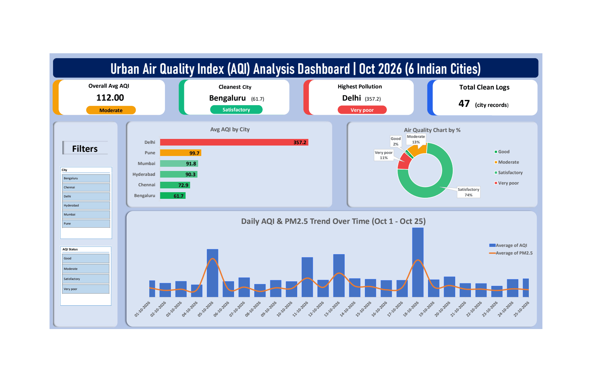

# Urban-AQI-Excel-Dashboard
Interactive Microsoft Excel BI dashboard analyzing Urban Air Quality Index (AQI) and PM2.5 trends across 6 Indian cities (Oct 2026) using dynamic PivotTables, INDEX/COUNTA KPI cards, and dual-axis combo charts.
# 📊 Urban Air Quality Index (AQI) Analysis Dashboard — Oct 2026

An interactive **Microsoft Excel Business Intelligence (BI) Dashboard** analyzing Air Quality Index (AQI) and fine particulate matter (**PM2.5**) trends across **6 major Indian cities** (`Bengaluru`, `Chennai`, `Delhi`, `Hyderabad`, `Mumbai`, and `Pune`) for October 2026 (**47 validated city records**).



---

## 🎯 Project Objective
To transform raw environmental monitoring logs into an executive, slicer-driven dashboard that highlights regional pollution disparities, tracks overall air quality distribution, and isolates the primary particulate driver behind daily AQI surges.

---

## 🔍 Key Analytical Findings
* **Overall Baseline (`112.00` Avg AQI — Moderate):** Across all 47 logged records, average air quality sat 12 points above the `100` safe threshold.
* **5.8x Regional Pollution Gap:** **Delhi** recorded severe air quality at **`357.2` (Very poor)**—nearly **5.8x higher** than the cleanest city, **Bengaluru (`61.7`, Satisfactory)**. **Pune (`99.7`)** sat directly on the Moderate boundary.
* **Air Quality Severity Distribution:** **76%** of readings remained within acceptable limits (**74% Satisfactory**, **2% Good**), while **13%** fell into **Moderate** and **11%** reached **Very poor** levels.
* **Primary Pollution Driver (`PM2.5`):** Overlaying daily `Average of AQI` against `Average of PM2.5` confirms that sharp particulate surges (notably on **Oct 5, Oct 11, Oct 13, and peaking on Oct 18**) directly drive overall daily AQI spikes.

---

## 🛠️ Dashboard Architecture & Excel Techniques
* **Hidden Backend Engine (`pivot tables` Sheet):** Built 4 decoupled PivotTables (`PT1`–`PT4`) so visual elements remain cleanly separated from raw data transformations.
* **Dynamic Formula-Driven KPI Cards:** Used `INDEX` + `COUNTA` + `TEXT` formulas to automatically extract and format the cleanest and highest-pollution cities dynamically—even when filtered via slicers:
  ```excel
  =INDEX(D2:D7, COUNTA(D2:D7)) & " (" & TEXT(INDEX(E2:E7, COUNTA(E2:E7)), "0.0") & ")"
